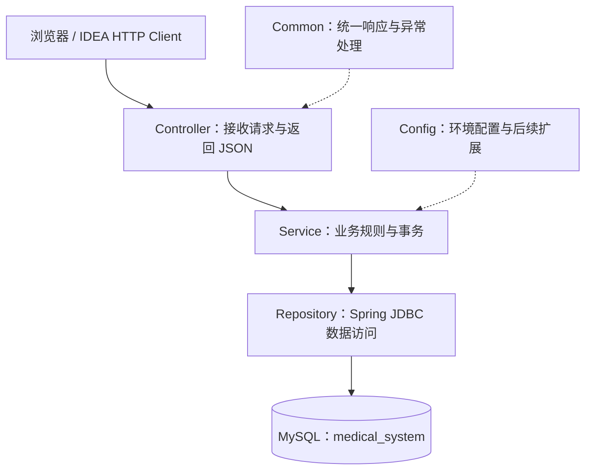
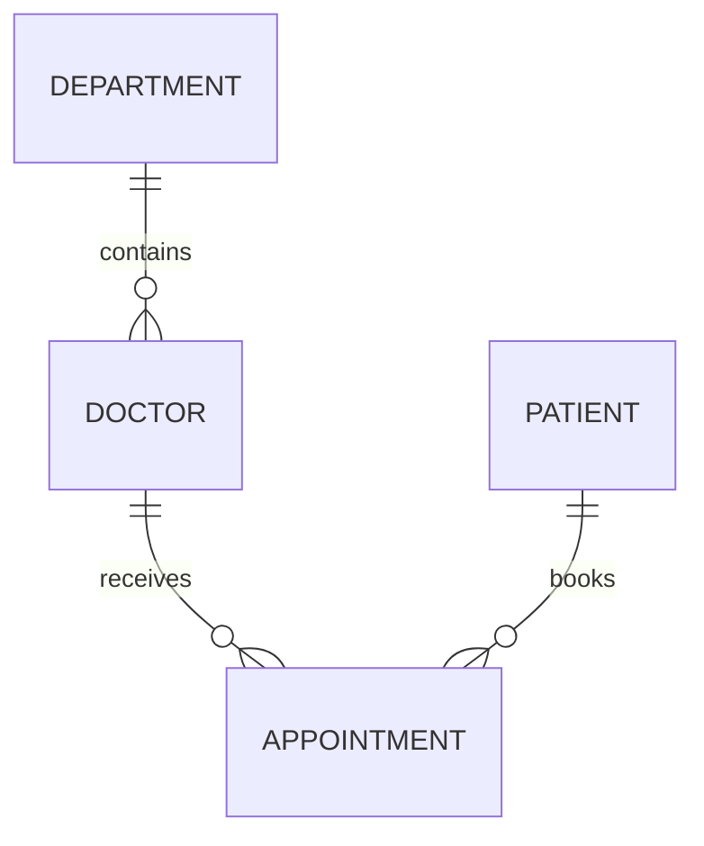

# 实验一：医疗管理系统框架设计与环境搭建指导

本文件主要保留实验一的初始架构与环境指导。当前工程已在此基础上完成科室管理页面及增删改查，最新功能和验收步骤见 [科室管理实验操作步骤](科室管理实验操作步骤.md)。

## 一、项目定位与完成边界

项目名称：医疗管理系统。后续最小业务闭环为“维护科室与医生 → 登记患者 → 预约挂号 → 查询或取消预约”。采用 Spring Boot 单体应用与 MySQL，便于理解分层、调试、提交和本地验收。

实验一交付可运行的基础工程：环境配置说明、Git 规范、启动类、Controller、统一响应、数据库脚本和一次真实数据库查询。患者、医生和挂号的增删改查、登录、权限与排班在后续实验实现。

不将完整业务系统开发压入环境搭建实验。框架中的患者、医生、挂号数据库表属于后续扩展基础，当前不具备对应业务接口。

## 二、功能模块规划

| 模块 | 内容 | 实验一状态 | 后续扩展 |
| --- | --- | --- | --- |
| 工程基础 | 启动配置、统一响应、编码、异常处理 | 已提供源码 | 日志追踪、分页约定 |
| 系统测试 | 首页、Hello World、项目信息 | 已提供源码 | 应用监控 |
| 数据库诊断 | 实际执行 SELECT 1 | 已提供源码，需本机 MySQL 验收 | 部署环境诊断 |
| 科室管理 | 科室列表 | 已提供查询示例 | 新增、修改、停用 |
| 医生管理 | 医生基本信息、所属科室 | 仅有表结构 | 医生查询与排班 |
| 患者管理 | 患者基本资料 | 仅有表结构 | 参数校验、分页查询 |
| 预约挂号 | 患者、医生、预约时间、状态 | 仅有表结构 | 预约、取消、号源控制 |
| 用户权限 | 管理员、医生、患者角色 | 规划 | 登录、授权与操作审计 |

## 三、技术架构



以科室查询为例：`GET /api/departments` → `DepartmentController` → `DepartmentService` → `DepartmentRepository` → `department` 表 → 统一 JSON。

各层职责：

- Controller 处理 HTTP 路由、参数接收、请求校验及响应，不直接写 SQL。
- Service 表达业务规则；后续预约、取消等多步写操作在这里定义事务。
- Repository 负责数据库访问和结果映射。新增带输入条件的查询时使用参数绑定。
- Entity 表达数据；DTO 表达输入；VO 表达组合输出。简单的科室只读示例直接返回不含敏感字段的实体。
- Common 存放 `ApiResponse`、统一异常处理；Config 留给后续公共配置。

不为只有一条语句的示例强制增加 Service 接口与 Impl。出现多个实现或课程明确要求时再拆分。

统一响应示例：

```json
{
  "code": 0,
  "message": "success",
  "data": "医疗系统 Hello World！"
}
```

`code=0` 表示成功；数据库异常示例使用 `code=50301`，同时返回 HTTP 503。后续参数错误应返回 HTTP 400，资源不存在返回 HTTP 404。

## 四、环境安装与配置流程

### 4.1 建议工具链

本工程固定 JDK 17、Spring Boot 3.5.7，Maven 使用 3.9.x，MySQL 使用 8.x。Boot 版本是用于复现实验的示例版本，不表示最新版本；版本由 `pom.xml` 统一控制，MySQL 驱动使用 Spring Boot 依赖管理提供的版本。

下载与说明入口：

- JDK：<https://adoptium.net/temurin/releases/?version=17>
- Maven：<https://maven.apache.org/download.cgi>
- MySQL：<https://dev.mysql.com/downloads/>
- IDEA：<https://www.jetbrains.com/idea/download/>
- Git：<https://git-scm.com/downloads>
- Spring Boot 3.5 兼容性说明：<https://docs.spring.io/spring-boot/3.5/system-requirements.html>
- Maven 安装说明：<https://maven.apache.org/install.html>

这些是官方入口；访问受限时记录真实网络问题，不能据此宣称下载或安装成功。

### 4.2 JDK

1. 安装完整 JDK 17，例如 `C:\dev\jdk-17`。
2. 将 `JAVA_HOME` 设置为 JDK 根目录，不要指向 `bin`。
3. 在 PATH 前部添加 `%JAVA_HOME%\bin`，检查旧 JDK 路径是否抢先命中。
4. 重新打开 PowerShell，执行：

```powershell
where.exe java
java -version
javac -version
```

必须同时能运行 `java` 与 `javac`。当前电脑默认检测到 JDK 8，因此不能直接用于本工程的 Java 17 源码；可先按 README 临时切换到 IDEA 随附的 JDK 17。

### 4.3 Maven

1. 解压 Maven 3.9.x，例如 `C:\dev\apache-maven-3.9.x`，实际目录名以下载版本为准。
2. 将其 `bin` 加入 PATH；可设置 `MAVEN_HOME` 为 Maven 根目录。
3. 执行 `mvn -version`，确认输出中的 Java 主版本也为 17。
4. 本项目用 `mvn -s config/maven-settings-central.xml clean test package` 显式选择配置。
5. IDEA 中检查 Maven Home、User settings file、Local repository；IDEA 与终端若配置不同，会出现一边成功、一边失败。

镜像文件是可选模板，不保证任何第三方镜像永久有效。恢复 Maven Central 后仍失败时，应检查代理、证书和网络，不重复更换 POM 的业务依赖。

### 4.4 MySQL

1. 安装 MySQL Server，记录服务名、端口、管理员账号及口令；只有命令行客户端不代表服务端已经安装或运行。
2. 查看 Windows 服务状态及监听端口：

```powershell
Get-Service -Name '*mysql*'
Get-NetTCPConnection -LocalPort 3306 -State Listen -ErrorAction SilentlyContinue
```

3. 使用客户端连接，查询服务端版本与编码：

```sql
SELECT VERSION(), @@port;
SHOW VARIABLES LIKE 'character_set_server';
SHOW VARIABLES LIKE 'collation_server';
```

4. 按 README 执行建库、建表、账号配置。
5. 用 `medical_app` 成功连接后，再启动 `mysql` 模式，验证数据库接口和科室接口。

### 4.5 IDEA 与 Spring Boot 创建

如果自主创建工程，可在 Spring Initializr 选择 Maven、Java、JAR，Java 选择 17，依赖选择 Spring Web、Validation、JDBC API、MySQL Driver；坐标使用 `com.example:medical-system`。网站可选 Boot 版本会变化，复现本框架时以附带 POM 为准。

也可直接在 IDEA 打开附带的 `pom.xml`，选择作为项目导入。普通 Maven 工程导入和 Java 主类运行不依赖额外 Spring 项目向导。

关键设置：

| 设置位置 | 目标 |
| --- | --- |
| Project SDK | JDK 17 |
| Project language level | 17 |
| Maven Importing / Runner 使用的 JDK | JDK 17 |
| Java Compiler 的目标字节码 | 17 |
| File Encodings 的项目及默认编码 | UTF-8 |
| Properties 默认编码 | UTF-8；已有文件转换时先确认原始编码 |

运行 `MedicalApplication.main()`；默认模式验收 Web，数据库模式在运行配置中增加 `--spring.profiles.active=mysql` 和数据库环境变量。

## 五、典型故障定位

| 故障 | 诊断依据 | 处理方法 | 复核 |
| --- | --- | --- | --- |
| JDK 不兼容 | `release version 17 not supported`、`UnsupportedClassVersionError` | 对比 `where.exe java`、`java -version`、`javac -version`、`mvn -version` 与 IDEA SDK；统一为 17 | 重新打开终端，构建并运行 |
| Maven 镜像失效 | `Could not transfer artifact`、连接超时或仓库 404 | 检查生效的 settings；切换 central 示例配置；确认代理、证书与网络；用 `-U` 重新解析依赖 | 构建成功并记录使用的仓库 |
| MySQL 3306 冲突 | 服务启动失败，端口已有监听 | 找出占用 PID 和对应程序；确认是否已有可复用 MySQL；必要时为新实例配置 3307，重启对应服务并同步 `DB_PORT` | 客户端及应用都使用同一端口并成功查询 |
| IDEA 中文乱码 | 文件内容、控制台、JSON 或查询结果显示异常 | 分别检查文件 UTF-8、Maven 源码编码、控制台编码、HTTP 编码、MySQL utf8mb4 | 中文 Hello 与科室名均正确 |
| Web 8080 冲突 | `Port 8080 was already in use` | 查明占用进程；将 `SERVER_PORT` 设置为 8081 后重试 | 访问 8081 的 Hello 接口 |
| 数据库账号认证失败 | SQL 账号、Host、口令与应用配置不一致 | 先使用相同 Host/端口/账号在客户端登录，再核对环境变量 | 数据库接口返回 connected=true |
| 运行启动但数据库没连上 | demo 模式仅证明 Web 可用，或 mysql 模式接口返回 503 | 启用 mysql 模式，确认初始化 SQL、服务及账号 | 数据库和科室接口同时通过 |

定位端口占用示例：

```powershell
$portOwner = Get-NetTCPConnection -LocalPort 3306 -State Listen -ErrorAction SilentlyContinue
$portOwner | Select-Object LocalAddress, LocalPort, OwningProcess
$portOwner | ForEach-Object { Get-Process -Id $_.OwningProcess }
```

修改 MySQL 实例端口时，编辑该实例实际使用的 `my.ini` 中 `[mysqld]` 下的 `port=3307`，使用管理员权限重启对应 MySQL 服务，再设置 `$env:DB_PORT='3307'`。不要直接结束未知占用进程。

Maven 镜像排错示例：

```powershell
mvn -s config/maven-settings-central.xml help:effective-settings
mvn -U -s config/maven-settings-central.xml clean test package
```

若错误集中在某个依赖的 `.lastUpdated` 缓存，确认网络恢复后用 `-U` 重试，必要时仅处理对应依赖版本目录。TLS/证书失败应检查系统时间、代理与可信证书，不以关闭证书校验作为修复方法。

如果源文件原本已经是乱码，修改编码选项不会自动恢复原文，需要从正确版本恢复内容后再以 UTF-8 保存。MySQL 原有乱码数据也需要单独修复。

## 六、数据库框架



| 表 | 关键字段 | 用途 |
| --- | --- | --- |
| department | id、code、name、description | 科室；code 唯一 |
| doctor | id、department_id、name、title | 医生归属科室 |
| patient | id、name、gender、birth_date、phone | 患者基本资料；生日存日期，年龄在展示时计算 |
| appointment | id、appointment_no、patient_id、doctor_id、appointment_time、status | 预约关系、时间和状态；预约号唯一 |

一名医生归属一个科室，一名患者可有多条预约，一名医生可接收多条预约。所有表使用自增主键、外键和创建时间；SQL 可重复执行，不删除已有数据，但不会自动迁移已有表结构。

当前表只表达预约的基本关系，**尚未实现排班、容量与防超卖**。后续可增加 `doctor_schedule`（医生、日期、时段、总号源、剩余号源），预约关联排班记录，在 Service 事务内通过带条件更新扣减号源，并结合唯一约束或幂等键防止重复提交。

用户登录另建 `sys_user`、角色及用户角色关系表，密码只存安全哈希。当前示例不提供登录和真实诊疗数据管理功能。

## 七、接口规划

| 方法 | 地址 | 用途 | 状态 |
| --- | --- | --- | --- |
| GET | `/` | 本地实验首页 | 已提供源码 |
| GET | `/api/hello` | Hello World 和中文验证 | 已提供源码 |
| GET | `/api/system/info` | 项目信息 | 已提供源码 |
| GET | `/api/system/database` | SELECT 1 验证连接 | 已提供源码，仅 mysql 模式 |
| GET | `/api/departments` | 科室列表，验证完整分层 | 已提供源码，仅 mysql 模式 |
| GET / POST | `/api/patients` | 查询 / 新增患者 | 后续设计 |
| GET | `/api/doctors?departmentId=1` | 按科室查询医生 | 后续设计 |
| POST | `/api/appointments` | 提交预约 | 后续设计 |
| PATCH | `/api/appointments/{id}/cancel` | 取消预约 | 后续设计 |

后续列表接口增加分页，新增/修改接口使用 DTO 和 Jakarta Validation；涉及患者的接口增加登录校验及角色授权。

## 八、Git 仓库与提交规范

分支建议：`main` 保存验收通过的版本，`develop` 集成开发，`feature/*` 开发具体功能。远程仓库可使用课程指定平台。

首次初始化，在项目目录执行；请先将示例姓名与邮箱替换为本人信息：

```powershell
git init -b main
git config user.name '你的姓名'
git config user.email '你的邮箱'
git add .
git commit -m "chore: 初始化医疗系统工程与实验一基础框架"
git switch -c develop
git switch -c feature/lab01-verification
```

在功能分支完成本人配置、验证和文档填写后，再提交实际改动：

```powershell
git add .
git commit -m "docs: 补充本机环境验证与实验截图索引"
git switch develop
git merge --no-ff feature/lab01-verification -m "merge: 集成实验一验证记录"
git switch main
git merge --no-ff develop -m "merge: 发布实验一验收版本"
git tag -a v0.1.0 -m "实验一：环境搭建与工程初始化"
git log --oneline --graph --all
```

提交注释采用 `类型: 简短说明`：`feat` 新增功能、`fix` 修复问题、`docs` 文档、`test` 测试、`chore` 工程配置。注释说明具体改动，避免仅写“修改”“提交作业”。没有文件变化时无需为了凑记录重复提交。

在平台创建空仓库后，用实际地址替换以下占位符。以下命令需要本人账号权限：

```powershell
git remote add origin <你的实际Git仓库地址>
git push -u origin main
git push -u origin develop
git push origin v0.1.0
```

尖括号占位符须整体替换，不能原样执行。私有仓库应按课程要求为教师授予查看权限。当前交付未创建 Git 仓库、未生成本人提交身份或远程地址。

## 九、验收与提交清单

| 课程要求 | 操作与证据 |
| --- | --- |
| JDK / Maven 环境 | `java -version`、`javac -version`、`mvn -version` 截图，版本一致 |
| MySQL 环境 | 服务运行、SELECT VERSION()、端口、建库建表与账号登录截图 |
| IDEA 配置 | SDK、Maven Runner、UTF-8 设置与主类启动日志 |
| Git 规范 | 仓库地址、main/develop 分支、实际提交图与清晰注释 |
| Hello World | 浏览器地址栏与 JSON 返回截图 |
| 完整初始化 | 源码、分层目录、配置、SQL、MySQL 模式查询结果 |
| 故障定位 | 四类故障的现象、原因、修复和复验；未实际遇到的须标注“模拟演练” |
| 实验报告 | 本人信息、实验步骤、真实结果、问题分析、总结与附件索引 |

如果题目中的“4”指 4 学时，可按约 180 分钟安排：环境与版本检查 55 分钟，Git 和工程创建 35 分钟，接口与数据库联调 55 分钟，排错记录与报告 35 分钟。该时长安排为建议，以教师明确要求为准。
